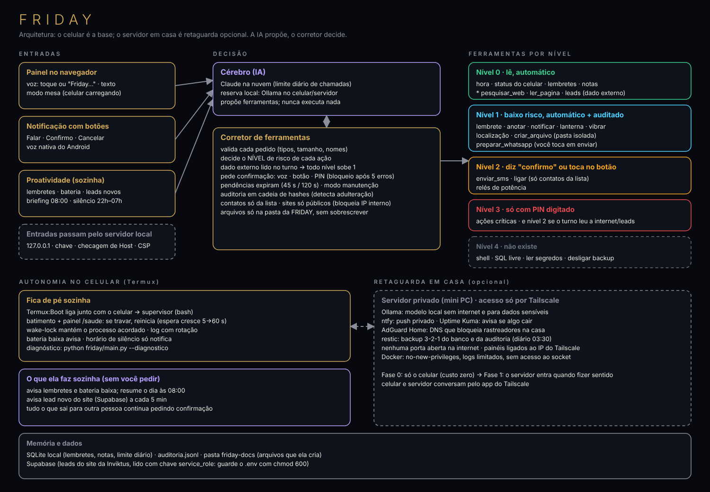

# Arquitetura da FRIDAY

## Ideia central
A IA **propõe**, o **corretor decide**. O modelo de linguagem nunca executa nada: ele só devolve "quero chamar a ferramenta X com estes argumentos". Quem valida, classifica o risco, pede confirmação, executa e registra é código comum (`friday/broker.py`), que você pode ler e testar. Assim, mesmo que o modelo seja enganado por um texto malicioso, o estrago é limitado pelo que o corretor deixa passar.

## Camadas
| Camada | Arquivos | O que faz |
|---|---|---|
| Entradas | `main.py`, `hud.html`, `acao.sh` | Painel web (voz/texto), botões da notificação, voz nativa do Android, teclado, voz local (Pi/PC) |
| Cérebro | `cerebro.py` | Claude na nuvem com ferramentas; reserva local (Ollama); limite diário de chamadas |
| Corretor | `broker.py`, `privacidade.py` | Validação de argumentos, níveis 0–4, contaminação, confirmação presa à ação, PIN, expiração, auditoria em hashes sem o conteúdo dos pedidos. Também devolve o resultado **estruturado** (`executar_estruturado`) e avisa observadores quando uma ação roda, é cancelada, expira ou é substituída |
| Experiências, planejador e objetivos próprios | `experiencias.py`, `planejador.py`, `objetivos.py` | Cada tarefa terminada vira uma experiência (hipótese gravada antes de agir, esperado × observado, causas tipadas); o planejador escolhe a estratégia num catálogo em código, troca se uma falhar e confere o efeito; ela pode propor objetivos, que só rodam com o «aprova» do dono. Contratos em [EXPERIENCIAS.md](EXPERIENCIAS.md) e [PLANEJADOR.md](PLANEJADOR.md) |
| Coordenação e retomada | `coordenador.py`, `retomada.py` | Duas ações no mesmo recurso (relé, contato, arquivo, cofre) não rodam juntas: a segunda espera; as independentes continuam em paralelo. Cada proposta recebe nota (relevância, urgência, custo, risco, incerteza) e uma decisão explicada e registrada, e `pedir_dono` nunca sai por nota alta. Depois de reinício ou queda, a retomada confere por fora o que ficou pela metade e **nunca repete o que pode já ter acontecido e não dá para conferir**. Contratos em [COORDENADOR.md](COORDENADOR.md) e [RETOMADA.md](RETOMADA.md) |
| Tarefas e conferência | `tarefas.py`, `verificacao.py` | Registro de tarefas com plano, estados e histórico; cada passo vai ao corretor e o **efeito é conferido por fora** (resposta da ferramenta não prova nada). Contrato em [TAREFAS.md](TAREFAS.md) |
| Ferramentas | `catalogo.py`, `ferramentas.py`, `android.py`, `internet.py`, `criar.py` | O que ela de fato faz |
| Proatividade | `ferramentas.proativo` | Lembretes, bateria, leads, briefing; respeita o silêncio noturno e o modo foco |
| Personalidade | `cerebro._system`, `telemetria.py` | Persona (tratamento, humor seco, antecipa), briefing e relatório falados sem IA, clima, cache do painel em segundo plano |
| Protocolos | `protocolos.py` | Sequências nomeadas disparadas só por você; cada passo passa pelo corretor |
| Autonomia | `autonomia.py`, `termux/` | Modos (desligada/assistente/piloto), rotinas por hábito, vigília; boot, supervisor, wake-lock, diagnóstico |
| Memória e cérebro | `memoria.py`, `neuronios.py`, `anatomia.py` | Cofre Obsidian: neurônios = notas, sinapses = ligações (Hebb, **sem teto**), sono (o fraco adormece, equilíbrio, repasse, sonhos), regiões da página da UFES. **Nada é apagado**: esquecer = arquivar |
| Visão (lobo occipital) | `visao.py` | Olhos: câmera do celular/painel/webcam/Pi/URL → imagem validada, sem localização e reduzida → modelo de visão sem ferramentas → um neurônio por coisa vista. Não reconhece rostos; só texto é guardado |
| Estado interno | `vida.py`, `estado.py` | Dopamina, serotonina, acetilcolina, energia, humor, primeiras vezes, sinais vitais; muda a velocidade de aprender e a vontade de estudar e conversar |
| Curiosidade | `curiosidade.py` | Estuda sozinha na internet com quarentena (`Estudos/`), limpa ordens, nunca leva dados seus na busca |
| Conversa | `conversa.py` | Puxa assunto, pergunta, conta o que estudou, brinca; falas por modelos prontos (sem IA) |
| Mãos | `maos.py` | Sentido novo: a câmera segue as SUAS mãos no navegador (MediaPipe) e você modela em 3D com gestos; só o nome do gesto e o modelo salvo chegam ao servidor |
| Pré-córtex | `prefrontal.py` | Junta o que ela quer fazer, decide, guarda metas e confere se deu certo; só lê o resto e não executa ferramenta. Contrato em [PREFRONTAL.md](PREFRONTAL.md) |
| Painel 3D | `cerebro3d.js`, `cerebro_pagina.html`, `hud.html` | Cérebro anatômico (Regiões) ou por tipo de memória, com a faixa do estado interno |
| Retaguarda | `servidor/` | Ollama, ntfy, Uptime Kuma, AdGuard, backup restic (opcional) |

## Níveis de risco
| Nível | Exemplos | Regra |
|---|---|---|
| 0 | hora, status, lembretes, notas, pesquisar, ler página | automático |
| 1 | criar lembrete, anotar, lanterna, localização, criar arquivo, preparar WhatsApp | automático + auditado |
| 2 | enviar SMS, ligar, relé de potência | confirmação explícita **da ação anunciada** (ver «Confirmação de ação sensível») ou o botão daquela pendência |
| 3 | ações críticas | só PIN digitado (5 erros bloqueiam por 1 min) |
| 4 | shell, SQL livre, ler segredos, desligar backup | **não existem** como ferramenta |

**Contaminação:** ferramentas que trazem dado de terceiros (internet, leads) marcam o turno como contaminado. Depois disso todo nível ≥ 1 sobe um degrau (máx. 3). É a defesa contra *prompt injection*: uma página que diga "mande um SMS para…" cai em exigir o PIN, que a página não tem.

## Confirmação de ação sensível (nível 2)
Existe **uma** ação pendente por vez, em memória (45 s no nível 2, 120 s no nível 3; reiniciar o programa descarta). Quando a IA propõe uma ação de nível 2, o corretor devolve «AÇÃO PENDENTE» e a resposta falada termina com a frase do **próprio corretor** (`frase_pendente`): o que será executado, com os argumentos principais e o tipo de confirmação. Quem descreve a ação é o corretor, não a IA.

| O que o dono diz | Efeito |
|---|---|
| «confirmo» / «confirmado» / «autorizo» **logo depois** do anúncio (nenhuma outra fala no meio) | executa |
| «confirmo enviar sms» (verbo de consentimento **mais** o nome da ação), a qualquer hora enquanto a pendência vale | executa |
| «confirmo» sozinho depois de outra conversa | **não** executa; o corretor repete a ação e pede a frase inteira |
| «sim», «pode», «isso», «pode fazer», ou «pode mandar o aviso» | **não** executa (ambíguo: pode ser resposta a outra pergunta); pede a frase inteira |
| «cancela», «não», «esquece», «deixa pra lá» | cancela |
| botão *Confirmo* do painel ou da notificação | executa **só se o id do botão for o da pendência atual** |

Uma pendência nova **substitui** a anterior (a trilha registra `substituido`); confirmar não reaproveita pendência já executada, cancelada ou expirada. Nível 3 só executa com o PIN digitado. `tests/test_confirmacao.py` cobre isto, incluindo ação trocada entre o anúncio e o toque no botão.

## Trilha de auditoria: o fato, não o conteúdo
`auditoria.jsonl` registra **que** algo foi feito, não **o quê**. Por linha: ferramenta, nível, decisão, hash encadeado e, no lugar do conteúdo, um resumo: números e verdadeiro/falso ficam, texto vira «‹texto: N caracteres›» (exceto identificadores curtos que a própria ferramenta declara em `audit_args`, como o relé ou o apelido do contato), links ficam só com o servidor, o resultado vira um código (`ok`, `Erro`, `faixa:minutos`…) mais o tamanho. Uma camada final (`privacidade.redigir`) mascara cartão, CPF/CNPJ, telefone, e-mail, chaves, tokens e «senha é …» em qualquer texto que algum módulo grave.
Limites conhecidos: a redação não pega endereço ou nome escritos por extenso (por isso a regra principal é não gravar o conteúdo); linhas antigas, escritas antes desta mudança, continuam como estavam (a cadeia de hashes impede editá-las — para começar limpo, mova `auditoria.jsonl` para outro lugar e o corretor abre uma cadeia nova).

## Validação de argumentos
Cada ferramenta declara o que aceita (`type`, `required`, e por parâmetro `minimum`, `maximum`, `maxLength`, `enum`). O corretor **recusa** o que está fora («Pedido inválido: minutos deve estar entre 0.1 e 43200 (recebi -5)»), inclusive NaN e infinito, e não executa nada. Só ajusta onde o parâmetro declara `ao_exceder="limitar"` (hoje: quantas notas ler, de quantas horas são os leads e a duração da vibração, todos sem efeito colateral), e nesse caso a resposta diz o que mudou («ajustei limite de 50 para 20») e a trilha guarda `ajustes`. Os mesmos limites vão no esquema que a IA recebe. A trilha guarda só o código da recusa.

## Fluxo de um pedido
1. Voz, texto ou botão chega em `/falar` (servidor local, exige chave e `Host` válido).
2. Se há ação pendente, o corretor trata a fala **antes** do modelo (consentimento claro executa, cancelamento cancela, resposta vaga pede a frase inteira, conversa comum segue adiante).
3. Se o texto é um protocolo ("bom dia", "modo foco"), `protocolos.py` executa, sem gastar IA; os passos de ferramenta ainda passam pelo corretor.
3b. Depois vêm, sem gastar IA, nesta ordem (`main.processar`): «desligue-se» (só explica), autonomia, protocolo, memória ("lembre que…"), cérebro ("mostre seu cérebro"), estado interno ("como você está?"), visão ("olhe"), mãos ("meus modelos 3d"), pré-córtex ("quais são as suas metas?"), tarefas ("quais são as minhas tarefas?", "cancela a tarefa 3"), retomada ("retoma o que ficou pendente"), experiências ("o que você aprendeu com as tarefas?"), objetivos que ela propõe ("aprova o objetivo 2"), coordenação ("o que você está coordenando?"), curiosidade ("estude sobre…"), brincadeiras e a resposta a uma pergunta que ela fez.
4. Senão o cérebro responde, podendo pedir ferramentas; cada pedido passa pelo corretor. As que **mudam algo** viram uma tarefa de um passo (`tarefas.executar_registrado`), e o efeito é conferido: se a ferramenta disse «feito» e o efeito não existe, a IA recebe o aviso antes de falar com você.
5. Ação de nível 2/3 vira *pendente*: o corretor devolve "AÇÃO PENDENTE…", o modelo explica a você, o corretor acrescenta a frase do que será executado, e a execução só acontece depois da confirmação.
6. Tudo (automático, pendente, confirmado, negado, expirado) vai para `auditoria.jsonl`, em cadeia de hashes SHA-256; o painel mostra ✔ íntegra ou ✖ adulterada.

## Defesas e o que cada uma barra
| Ameaça | Defesa |
|---|---|
| Texto malicioso manda a IA agir | níveis + contaminação + PIN; ferramentas que não existem |
| IA inventa um número de telefone | SMS/ligação só para nomes da lista `CONTATOS` |
| Página tenta alcançar a rede interna (SSRF) | `internet.py` só abre sites públicos, revalida cada redirecionamento, limita tamanho/tipo |
| Site de fora ou outro app chama a API local | chave no cabeçalho, checagem de `Host`, sem CORS, CSP, `X-Frame-Options` |
| Arquivo criado sobrescreve/escapa | pasta isolada, nome simples, extensões permitidas, nunca sobrescreve, não segue link simbólico |
| Gasto descontrolado com a IA | `LIMITE_DIARIO` |
| Log adulterado | cadeia de hashes |
| Log que vira cópia dos seus dados | a trilha guarda o fato (tamanho, código, números) e não o texto dos pedidos nem das respostas; redação final de cartão, CPF, telefone, e-mail, chaves e links |
| «Sim» solto executando um SMS | só verbo de consentimento claro, preso à ação anunciada ou logo após o anúncio; o botão leva o id da pendência |
| Argumento absurdo virando outro em silêncio | o corretor recusa fora da faixa (inclusive NaN/infinito) ou ajusta de forma declarada, avisando |
| Travou ou caiu | supervisor com batimento e `/saude`, espera crescente |
| Madrugada | `SILENCIO`: só notifica |
| Página lida na curiosidade tenta dar ordens | resumo por IA sem ferramentas, `curiosidade.limpar` joga fora frases-ordem, links, e-mails e telefones; nota em quarentena (`origem: web`, «não verificado»); lembrar o estudo contamina o pedido |
| Busca na internet vazando dados seus | `curiosidade.consulta_segura`: sem nomes de pessoas guardadas, números, e-mails, links nem palavras de ordem |
| Estudo automático gastando a cota de IA | estudo por iniciativa dela usa no máximo metade do `LIMITE_DIARIO` |
| IA desligando a curiosidade ou a conversa | só por voz do usuário; nenhuma ferramenta faz isso (há teste) |
| IA tirando foto, ou mexendo na visão | nenhuma ferramenta faz isso (teste varre os nomes); só o usuário pede «olhe» ou liga/desliga o olhar espontâneo; o painel só manda imagem a um pedido dela |
| Texto escrito dentro de uma imagem manda a IA agir | a visão roda **sem ferramentas**, a instrução diz que texto na imagem nunca é ordem, o resultado é limpo (ordens, links, e-mails, telefones, dados sensíveis, frases sobre pessoas) e fica rotulado «[VISTO PELA CÂMERA, não verificado]»; lembrar isso contamina o pedido |
| Foto vaza localização, pessoas ou documentos | EXIF/GPS removido e imagem reduzida antes de qualquer análise; só JPEG/PNG/WEBP reais; pessoas só são contadas; documentos/cartões/senhas não são transcritos; a foto vai embora (opt-in `VISAO_GUARDAR_FOTOS`); `VISAO_NUVEM=0` mantém tudo local |
| Dois painéis abertos abrem duas câmeras | o servidor entrega cada pedido de foto a UM painel só |
| A IA (ou alguém pela tela) desligando a FRIDAY | não existe botão, rota, ferramenta nem fala que a pare; «desligue-se» só explica; a parada é do dono, fora dela (`termux/parar.sh`, `systemctl stop`) e ela não resiste (testes varrem código, rotas, painel e ferramentas) |
| Conhecimento sumindo | nenhuma exclusão de nota/sinapse no código (teste varre); esquecer arquiva em `Arquivo/`; sinapse fraca adormece e acorda ao ser relembrada |
| Ferramenta responde «feito» e não fez | `verificacao.py` olha o estado real (banco, arquivos, cofre); sem efeito, o passo fica `refutado` e a tarefa `FALHOU`. O que não dá para conferir (SMS, ligação, relé…) fica «executada, mas não consegui conferir» e só o dono conclui |
| Tarefa pulando a confirmação | a tarefa só chama `executar_estruturado`; nível ≥ 2 vira `BLOQUEADA` até o dono confirmar com a frase clara ou o botão do id; «sim»/«pode» não executam; cancelar uma tarefa só derruba a confirmação **dela** |
| IA criando ou mexendo em tarefas | nenhuma ferramenta faz isso (teste varre os nomes e as definições) |
| Objetivo proposto por ela executando sem o dono | só `objetivos.aprovar`, chamado só pela fala do dono; tipo permitido pelo catálogo, nível ≤ 1, limites do código (testes `test_objetivos`: ambíguo nunca aprova, arquivo adulterado não autoriza) |
| Duas ações pisando no mesmo recurso | `coordenador.py` reserva o recurso antes de cada passo (tudo ou nada); quem não consegue espera e, se passar de `ESPERA_RECURSO_S`, a tarefa fica `PRONTA` sem executar e diz por quê (testes `test_coordenador`, medido antes e depois em `reports/evidencias/cenarios/fase5_6/`) |
| Retomada repetindo uma ação que já aconteceu | `tarefas.recuperar` confere o efeito por fora; o que não dá para conferir vira `PRECISA_INTERVENCAO` e **não** é repetido; passo que derrubou o programa 2 vezes também não; pedido da conversa, nível ≥ 2 e tarefa velha não são retomados sozinhos (testes `test_retomada`, queda real de processo) |
| Experiência dando permissão ou alterando o modelo | não: só reordena estratégias já permitidas; nenhum peso de IA muda |
| IA disparando protocolo ou "modo foco" sozinha | protocolos só rodam por pedido do usuário; a IA não tem ferramenta para isso (só `silenciar`/`voltar_a_falar`, nível 1, auditadas) |

## Módulos que não estão no fluxo principal
- `pre_cortex/` (pré-córtex distribuído): nove neurônios de software que colaboram por mensagens JSON, no mesmo processo ou em processos separados; ver [PRE_CORTEX.md](PRE_CORTEX.md).
- `nucleo.py` (atenção e observabilidade): integrado ao `main.py` para registrar sinais sem guardar o texto integral do usuário e expor o foco no painel. Não escala tarefas nem bloqueia impulsos. O pré-córtex distribuído continua responsável pelo planejamento entre neurônios/processos; o [coordenador](COORDENADOR.md) reserva apenas recursos conflitantes; o corretor mantém a autoridade de execução. Ver [NUCLEO.md](NUCLEO.md).
- `simbiose.py` também não é importado por nenhum módulo, mas **é usado**: o hook de início de sessão do Claude Code (`.claude/hooks/simbiose.sh`) o executa para mostrar o resumo do cérebro e os pedidos de evolução.

## Formas de montar
1. **Celular sozinho (agora):** Termux faz tudo. Custo zero. Celular desligado = ela parada.
2. **Pi/PC com voz local:** `python friday/main.py` (openWakeWord + Whisper + Piper) para ouvir "hey jarvis" sem depender do Google; relés GPIO.
3. **Com servidor em casa:** o celular continua a base; o servidor entra como retaguarda (Ollama para dados sensíveis/sem internet, ntfy, monitor, DNS, backup). Fala-se por Tailscale, sem abrir portas.
4. **Sempre ligada (celular desligado):** a própria FRIDAY roda no servidor/Raspberry Pi com microfone e câmera dele; o celular é só uma janela (`servidor/README.md`).

## O que NÃO está pronto
- Palavra de ativação e câmera com a tela apagada no Android (exige app nativo; o Android recente bloqueia a câmera em segundo plano).
- Reconhecer pessoas/rostos: **de propósito não existe**. Reconhecer objetos novos depende do modelo de visão que você configurar (a qualidade real não foi medida).
- Pedido livre virar objetivo do planejador (hoje há 3 tipos no catálogo, chamados por código ou por proposta aprovada). Aprender com o resultado das tarefas, replanejar quando uma estratégia falha, coordenar recursos e retomar depois de reinício **já existem** (Fases 3 a 6). Retomada em celular real (Termux, kill do Android) e a coordenação de protocolos/rotinas da autonomia (que chamam o corretor direto) não foram exercitadas.
- Satélite de voz Pi → servidor (Wyoming).
- WhatsApp Business API (hoje só prepara a mensagem; você toca em enviar).
- Chave limitada para ler leads (hoje usa `service_role`; o ideal é uma função/papel só de leitura).
- Timbre real da voz e desempenho do painel em celular fraco (ajuste fino de `TTS_*` e animações só no seu aparelho).
- Testes em celular, microfone e GPIO reais; o compose do servidor foi validado só na sintaxe.
