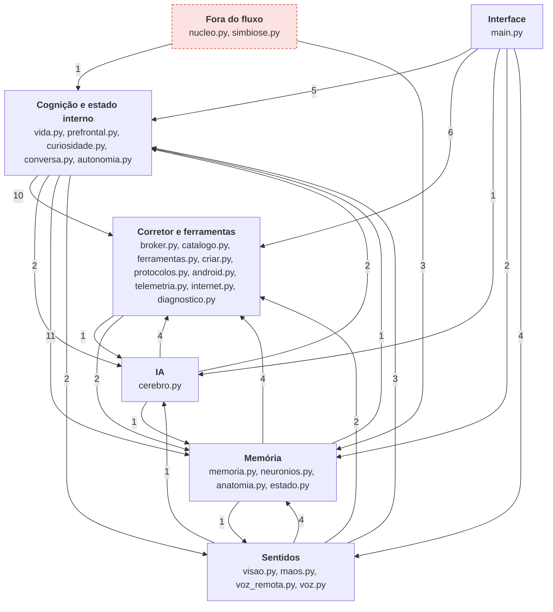
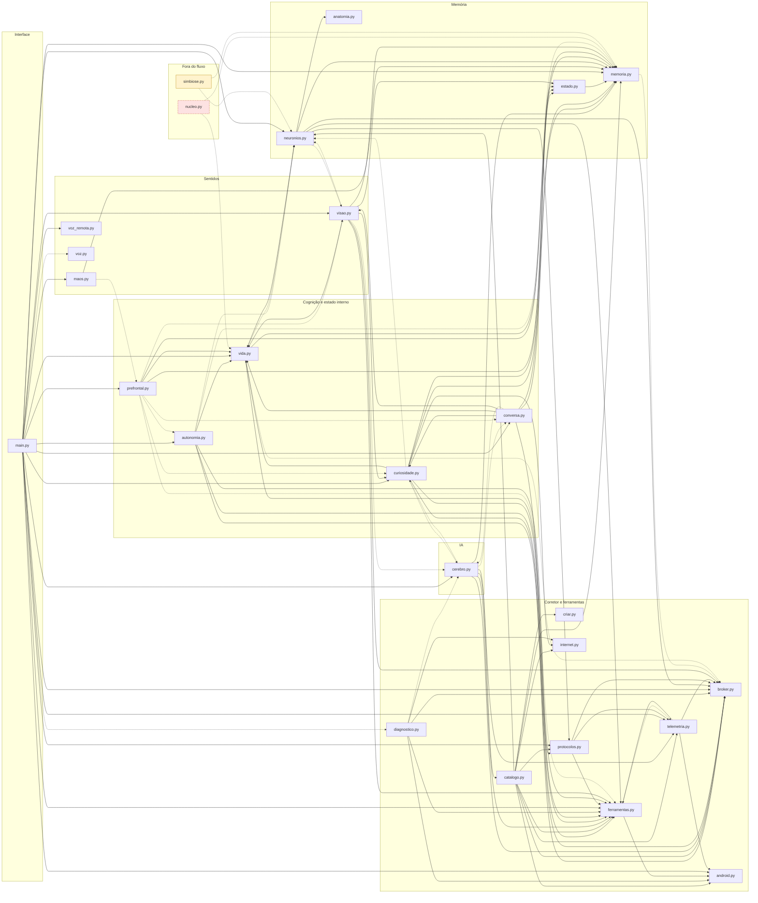
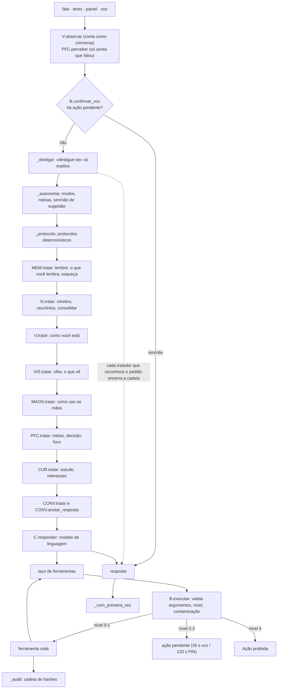
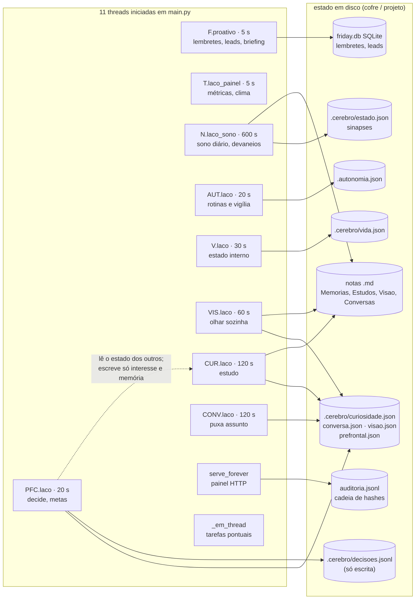
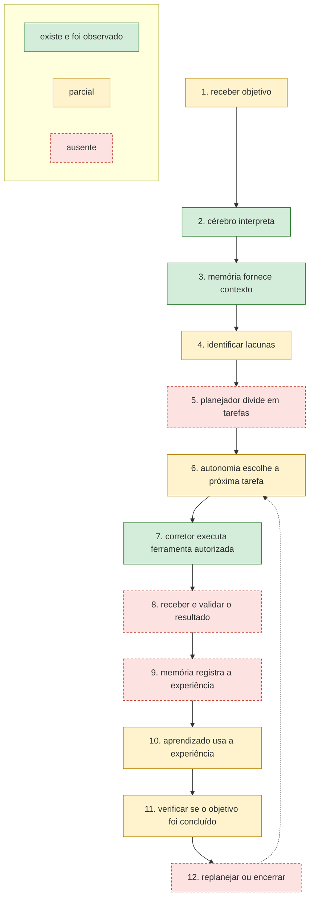
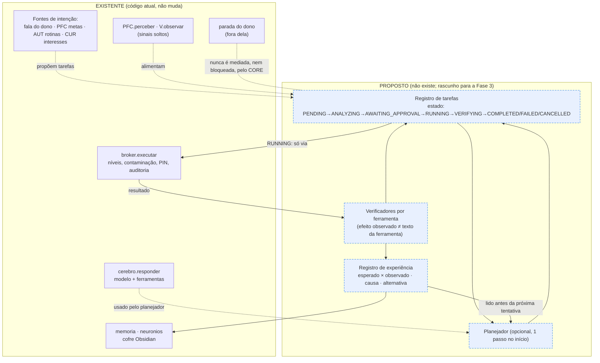

# Mapa de integração da FRIDAY

- **Data:** 24/10/2026. **Base:** análise por AST de `friday/*.py` (`evidencias/logs/inventario_modulos.json`), leitura de `main.py`, e execuções registradas em `evidencias/logs/`.
- **Atualização:** o retrato abaixo é o de antes da evolução. As diferenças da Fase 1 estão na §6, as da Fase 2 na §7 e as das Fases 3 a 6 na §8 (fim do documento).
- **Como ler:** setas **contínuas** são dependências reais encontradas no código; setas **pontilhadas** em §1 são imports tardios (dentro de função). O diagrama da §5 mostra o que seria **proposto** e está em tracejado azul, separado do que existe. Nada na §5 existe no código.

---

## 1. Dependências reais entre módulos

26 módulos Python, **103 arestas de importação interna**: 76 no nível do módulo e 27 tardias (feitas dentro de funções). Só `main.py` importa quase todos (18 módulos); ninguém importa `main`.

### 1.1 Visão por camadas (números = quantas importações cruzam a fronteira)

As camadas são um agrupamento meu para leitura; o código não tem pacotes. Uma linha entre camadas conta importações módulo a módulo (inclui as tardias).

### 1.2 Quem é mais usado (importações recebidas)

| Módulo | Recebe |
|---|---|
| `memoria` | 14 |
| `ferramentas` | 13 |
| `broker` | 12 |
| `vida` | 8 |
| `neuronios` | 7 |
| `android` | 5 |
| `telemetria` | 5 |
| `curiosidade` | 5 |

`memoria`, `ferramentas` e `broker` são o tronco comum. `broker` não importa nenhum módulo interno; `memoria` só o importa, e tardiamente.

### 1.3 Ciclos de importação

A análise de componentes fortemente conectados encontrou dois grupos cíclicos:

- `ferramentas` ⇄ `telemetria`
- `catalogo`, `cerebro`, `conversa`, `curiosidade`, `neuronios`, `vida`, `visao` (um único bloco de 7 módulos, com pares mútuos `cerebro`⇄`conversa`, `cerebro`⇄`curiosidade`, `neuronios`⇄`vida`, `neuronios`⇄`visao`)

O programa só funciona porque os 27 imports tardios quebram esses ciclos. **Consequência para a evolução:** qualquer camada nova que coordene esses módulos (o FRIDAY CORE) tem de ficar **acima** deles, importar os existentes e **nunca ser importada por eles**; senão cria um oitavo membro do bloco cíclico.

### 1.4 Módulos fora do fluxo principal

- `nucleo.py` — importado por ninguém, nem por testes (0% de cobertura). Em conflito de desenho com a decisão do dono (ver `AUDITORIA_COMPLETA.md` §8.1).
- `simbiose.py` — usado só pelo hook de início de sessão do Claude Code (`.claude/hooks/simbiose.sh`), não pelo programa.
- `voz.py` — importado tardiamente por `main.py`; Piper local, 0% de cobertura.

### 1.5 Grafo completo (denso)

Abrir o grafo com as 103 arestas

### 1.6 Lista de adjacência (as 103 arestas)

| Módulo | Importa no nível do módulo | Importa tardiamente (dentro de função) |
|---|---|---|
| `anatomia` | — | — |
| `android` | — | — |
| `autonomia` | `broker`, `ferramentas`, `protocolos`, `vida` | `memoria`, `neuronios` |
| `broker` | — | — |
| `catalogo` | `android`, `broker`, `criar`, `ferramentas`, `internet`, `memoria`, `neuronios`, `protocolos`, `telemetria` | — |
| `cerebro` | `broker`, `catalogo`, `ferramentas`, `memoria`, `telemetria` | `conversa`, `curiosidade` |
| `conversa` | `curiosidade`, `estado`, `ferramentas`, `memoria`, `vida`, `visao` | `cerebro` |
| `criar` | — | — |
| `curiosidade` | `broker`, `estado`, `ferramentas`, `internet`, `memoria`, `vida` | `cerebro`, `neuronios` |
| `diagnostico` | `android`, `broker`, `ferramentas`, `internet` | `cerebro` |
| `estado` | `memoria` | — |
| `ferramentas` | `android` | `telemetria` |
| `internet` | — | — |
| `main` | `android`, `autonomia`, `broker`, `cerebro`, `conversa`, `curiosidade`, `ferramentas`, `maos`, `memoria`, `neuronios`, `prefrontal`, `protocolos`, `telemetria`, `vida`, `visao`, `voz_remota` | `diagnostico`, `voz` |
| `maos` | `memoria` | `prefrontal` |
| `memoria` | — | `broker` |
| `neuronios` | `anatomia`, `broker`, `ferramentas`, `memoria`, `protocolos`, `vida` | `visao` |
| `nucleo` | — | `memoria`, `vida` |
| `prefrontal` | `estado`, `memoria`, `vida` | `autonomia`, `conversa`, `curiosidade`, `ferramentas`, `visao` |
| `protocolos` | `broker`, `ferramentas`, `telemetria` | — |
| `simbiose` | — | `memoria`, `neuronios` |
| `telemetria` | `android`, `broker`, `ferramentas` | — |
| `vida` | `ferramentas`, `memoria` | `broker`, `neuronios` |
| `visao` | `broker`, `curiosidade`, `estado`, `ferramentas`, `memoria`, `vida` | `cerebro`, `neuronios` |
| `voz` | — | — |
| `voz_remota` | — | — |

---

## 2. Fluxo real de um pedido (`main.processar`)

Cada tratador devolve texto ou `None`; o primeiro que reconhece o pedido encerra a cadeia. Só se nenhum reconhece é que o pedido chega ao modelo de linguagem.

**Divergência com a documentação:** `CLAUDE.md` descreve a ordem sem `MAOS.tratar` e sem `PFC.tratar` e sem o registro `PFC.perceber` na entrada. A ordem acima é a de `main.py:126-160`.

**O que o fluxo mostra:** o pedido não vira objeto. Não há identificador de tarefa, nem estado, nem lugar para registrar "tentei, deu errado por X". O corretor é o único ponto onde uma execução tem estado (uma ação pendente, em memória, com prazo).

---

## 3. Laços de fundo e estado em disco

| Laço | Intervalo | Portão que o limita | Lê | Escreve |
|---|---|---|---|---|
| `F.proativo` | 5 s | não verificado | SQLite (lembretes, leads), relógio | fala; marca lembrete |
| `T.laco_painel` | 5 s | — | clima, métricas | estado do painel |
| `N.laco_sono` | 600 s (devaneio a cada 3) | `AUT.modo() != "desligada"` | notas, sinapses | sinapses, links, dormentes |
| `AUT.laco` | 20 s | modo (assistente/piloto/desligada) | protocolos usados, relógio | `.autonomia.json`, trilha de auditoria |
| `V.laco` | 30 s | — | **trilha de auditoria (só leitura)** | `vida.json` |
| `VIS.laco` | 60 s | descanso, silêncio, conversa, VISAO_FONTE | câmera (se houver) | notas em `Visao/`, `visao.json` |
| `PFC.laco` | 20 s | — | estado de vida, curiosidade, conversa, visão, autonomia | `prefrontal.json`, `decisoes.jsonl`, `CUR.interesse`, notas de metas |
| `CUR.laco` | 120 s | ligada, descanso, 90 s sem conversa, vontade ≥ 0,55, bloqueio por falhas | internet, interesses | notas em `Estudos/`, `curiosidade.json` |
| `CONV.laco` | 120 s | descanso, silêncio, conversa em andamento (mutantes correspondentes foram detectados) | memória, estudos | fala; `conversa.json` |

Observações verificadas por execução:

1. Os laços **não se coordenam entre si**: cada um decide pelo próprio relógio e pelos próprios portões. O pré-córtex observa e "decide", mas só empurra `CUR.interesse` e grava memória; não dispara estudo, olhar nem conversa (`C2_autoestudo.log`: o `pensar()` diz `agir=['estudar']` e quem de fato estuda é `CUR.laco`, quando o portão dele abre).
2. O portão do estudo inclui "90 s desde a última conversa" (`curiosidade.py:499`). Na primeira execução (sem `vida.json`) o estado interno nasce com "última conversa = agora"; na cópia de teste foi preciso recuar esse marcador em 600 s para o estudo abrir (`C2_autoestudo.log`; `C3_dbg.log` mostra os demais portões livres e `segundos_desde_conversa = 0.0`). Com `vida.json` persistido o marcador vem do arquivo.
3. Só cinco laços entram em `vitais` (sono, vida, visão, curiosidade, conversa).

### Contratos entre módulos (verificados)

| De → Para | O que passa | Evidência |
|---|---|---|
| `main.processar` → `PFC.perceber` | evento "fala/pedido", sem texto | `main.py:130` |
| `maos` → `PFC.perceber` | nome do gesto | `maos.py:48` |
| `PFC` → `CUR.interesse` | peso 1,0 no tema da meta | `prefrontal.py:480`, `C2_autoestudo.log` |
| `vida.vigiar` ← `auditoria.jsonl` | falha de ação → erro → serotonina | `vida.py:251`, `vig.log` |
| `memoria.lembrar` → `neuronios` | co-ativação → sinapse → `[[link]]` | `E_sinapse2.log` |
| `curiosidade`, `visao` → `broker` (via `memoria`) | nota de origem web/câmera contamina o turno | `memoria.py:487,522`, `DH_estudo.log` |
| `cerebro` → `broker.executar` | toda ferramenta proposta pela IA | `H_llm.log` |

---

## 4. O fluxo cognitivo desejado × o que existe

Resumo: os passos 2, 3 e 7 funcionam; 1, 4, 6, 10 e 11 funcionam de forma parcial; 5, 8, 9 e 12 não existem. Tabela com evidência em `AUDITORIA_COMPLETA.md` §8.

---

## 5. Proposta de integração do FRIDAY CORE (NÃO EXISTE; só desenho)

Princípio: **coordenar o que já existe**, sem criar outro cérebro e sem duplicar responsabilidade.

### 5.1 Reaproveitamento por responsabilidade

| Responsabilidade do CORE | Já existe e deve ser reutilizado | Falta |
|---|---|---|
| Recebimento de eventos | `PFC.perceber` (saliência, habituação); `V.observar`; trilha de auditoria | Um ponto de entrada único; hoje cada laço lê o estado do outro |
| Contexto compartilhado | `PFC.observar()` (monta `q` com estado de vários módulos); `M.contexto_completo` para o prompt | Contexto **de tarefa**, versionado |
| Objetivos e tarefas | Metas do pré-córtex (aprender, ver, conhecer; ativa/cumprida/arquivada); rotinas; ação pendente do corretor | Tarefa genérica com estado, histórico e dono |
| Planejamento | `PFC.plano(meta, q)` (um passo) | Decomposição, dependências, alternativas |
| Priorização | `PFC.decidir` (valor por impulso, limiar pela serotonina) | Priorizar **tarefas**, não só impulsos |
| Memória | `memoria`, `neuronios` (completos) | Memória de **experiência** |
| Curiosidade | `curiosidade.py` (pipeline com quarentena) | Lacuna, pergunta de investigação, comparação de fontes |
| Execução de ferramentas | `broker` (completo) | Nada: **não duplicar** |
| Verificação dos resultados | Só o texto "Erro…" da ferramenta e `V.vigiar` (afetivo) | Verificadores de efeito |
| Aprendizado por experiência | `PFC.aprender` (calibração), hebbiano, hábito → rotina | Registro causal |
| Recuperação após falhas | Recuo de 30 min no estudo; supervisor e heartbeat do Termux (não verificados no aparelho) | Repetição/replanejamento por tarefa |
| Diagnósticos | `diagnostico.py`, `vitais`, `/state` | Incluir pré-córtex e tarefas |
| Agendamento | Lembretes (SQLite), rotinas (`AUT.tick`), laços por intervalo | Agendador de tarefas |
| Iniciativa autônoma limitada | Autonomia nível ≤ 1; PFC decide estudar/olhar/conversar | Iniciativa por tarefa com orçamento |

### 5.2 A máquina de estados proposta × o que já há

| Estado proposto | Equivalente hoje | Comentário |
|---|---|---|
| `PENDING` | meta ativa; sugestão da autonomia esperando "sim" | existe como fato espalhado |
| `ANALYZING` | `PFC.pensar` (decidir, planejar) | sem efeito colateral: serve |
| `AWAITING_APPROVAL` | `PEND` do corretor (45 s voz, 120 s PIN), só em memória | expira por desenho; precisa de estado "expirada" |
| `RUNNING` | `broker._rodar` | só pode ser alcançado **através** do corretor |
| `VERIFYING` | **não existe** | é a peça que faz o Teste G passar |
| `COMPLETED` | meta cumprida; resultado sem "Erro" | hoje sem verificação |
| `FAILED` | texto "Erro…"; recuo após 3 falhas | sem causa |
| `CANCELLED` | "cancelado" na trilha; meta arquivada; rotina cancelada | espalhado |

Avaliação completa no `PLANO_DE_EVOLUCAO.md` (Fase 3).

### 5.3 Restrições de projeto (decorrem das regras do projeto e da auditoria)

1. O CORE **não importa-se de volta**: fica acima do bloco cíclico (§1.3).
2. O CORE **nunca aprova**: aprovação continua só do corretor e do dono (nível 2 por voz, nível 3 por PIN).
3. O CORE **não tem acesso à parada**, nem a pode atrasar: a parada do dono é externa (`termux/parar.sh`, `systemctl`).
4. O CORE **não liga nem desliga** curiosidade, conversa, autonomia ou visão; isso é do dono, por voz.
5. Registros do CORE são **só de acréscimo** (regra 8: nada é apagado).
6. O CORE não faz o texto vindo de estudo ou câmera virar ordem: tarefas herdam a contaminação do turno de origem.
7. `nucleo.py` não é ligado; o destino dele é decisão do dono.

---

## 6. Atualização — Fase 1 (o que mudou no mapa)

- **Módulos:** 26 → 27 em `friday/`: novo `privacidade.py` (só biblioteca padrão, importado apenas por `broker.py`; **+1 aresta**: `broker → privacidade`). Nenhuma outra dependência entre módulos foi criada; nenhum ciclo novo.
- **Contratos que mudaram (todos com compatibilidade para quem não usa o recurso novo):**
  - `broker.registrar(..., rotulo=None, audit_args=())` e esquema com `minimum/maximum/maxLength/enum/ao_exceder`; `broker.executar` devolve «Pedido inválido: …» fora da faixa.
  - `broker.confirmar_botao(id)` (novo) e `POST /confirmar_voz` com `{"id": …}` — **muda a interface**: quem enviar `{}` não executa nada.
  - `broker.pendente_publico()` devolve também `id`, `resumo`, `rotulo`, `expira_em`; `broker.frase_pendente()` (novo).
  - `curiosidade.interesse(tema, peso, meta=None)` e `curiosidade.estudar(..., meta=None)`: o assunto estudado pode levar o id da meta («m3») em `temas[assunto]["m"]`.
  - `prefrontal.observar()` ganhou `estudos_por_meta`; metas ganharam `ligados` e `candidatos`; novas funções `ligar`, `chave_tema`.
  - `memoria._arquivos()` devolve lista (antes, gerador cortado em 3.000); `memoria._listar` novo; `curiosidade._nomes_de_pessoas` lê o cofre inteiro.
- **Fluxo de `processar()` (§2):** a ordem não mudou; `main.processar` passa a anexar a frase do corretor quando o pedido criou uma pendência (`_com_pendencia`).
- **§1.4 Módulos fora do fluxo:** `nucleo.py` segue sem importador e sem teste; agora tem `docs/NUCLEO.md` descrevendo o código e o estado (decisão na Fase 5). `simbiose.py` segue só no hook.
- **§4 Fluxo cognitivo desejado × existente:** inalterado. Os elos objetivo→plano→verificação→experiência ainda não existem (Fases 2–4); o progresso de metas de aprender agora usa relações explícitas, mas continua sem verificar o efeito de ferramentas.

## 7. Atualização — Fase 2 (o que mudou no mapa)

- **Módulos:** 27 → 29 em `friday/`: novos `tarefas.py` (registro e máquina de estados) e `verificacao.py` (conferência do efeito).
- **Novas dependências entre módulos (arestas):** `tarefas → broker, verificacao, estado, memoria, privacidade`; `verificacao → broker, ferramentas, criar, memoria, neuronios, privacidade`; `cerebro → tarefas` (as duas chamadas de ferramenta da IA); `main → tarefas` (comandos de voz e painel); `prefrontal → tarefas` (**só leitura**, `resumo_por_meta`; teste de AST garante que não cria nem executa tarefas). `broker` **não** importa `tarefas`: o sentido é o contrário, por eventos (`broker.OBSERVADORES`). Sem ciclo novo.
- **Contratos novos (o antigo continua valendo):**
  - `broker.executar_estruturado(nome, args, …)` → `{estado: executada|pendente|recusada|negada, texto, codigo, nivel, pendencia, erro, ajustes}`; `broker.executar` devolve o mesmo texto de antes.
  - `broker.OBSERVADORES`: eventos `executada|cancelada|expirada|substituida`, com argumentos e resultado só em memória; erro de observador é engolido; observador nunca chama o corretor.
  - `ferramentas.marca_lembretes/lembretes_depois/marca_notas/notas_depois` (só leitura).
  - `prefrontal.observar()` ganhou `tarefas_por_meta`; quarta via de evidência de meta: «tarefa conferida».
  - `main.estado_completo()` ganhou `"tarefas"` (contagens).
- **Fluxo de `processar()` (§2):** `TAR.tratar` entra logo depois de `PFC.tratar` («minhas tarefas», «cancela a tarefa N», «retomar a tarefa N», «a tarefa N está feita»).
- **Fluxo da IA (§2):** as duas chamadas de ferramenta passam por `tarefas.executar_registrado` → corretor (como sempre) → conferência do efeito → texto de sempre (com o aviso «NÃO encontrei» só quando o efeito foi refutado).
- **Estado em disco (§3):** `.cerebro/tarefas.json` (estado vivo, validado ao ler) e `.cerebro/tarefas_historico.jsonl` (só acrescenta).
- **§4 Fluxo cognitivo desejado × o que existe:** o passo 5 (dividir em tarefas) fica **parcial** (planos escritos por quem chama são executados; ninguém os gera); o 8 (receber e validar o resultado) passa de ausente para **existente** para as sete ferramentas conferíveis (o resto é «sem como conferir», dito como tal); o 11 (verificar se o objetivo foi concluído) passa a **existir** no nível da tarefa e da meta de aprender. Seguem ausentes: 9 (registrar a experiência — Fase 3) e 12 (replanejar — Fase 4). Os passos 1, 4, 6 e 10 não mudaram.
- **Fora do fluxo:** `nucleo.py` segue órfão (Fase 5). Protocolos, rotinas da autonomia e atalhos de voz da memória continuam chamando o corretor direto e **não geram tarefa**.

## 8. Atualização — Fases 3 a 6 (o que mudou no mapa)

- **Módulos:** 29 → 34 em `friday/`: novos `experiencias.py`, `planejador.py`, `objetivos.py`, `coordenador.py` e `retomada.py`.
- **Novas dependências entre módulos (arestas, conferidas nos `import`):** `experiencias → broker, memoria, tarefas, verificacao`; `planejador → broker, experiencias, memoria, privacidade, tarefas, verificacao` (do `broker` só o catálogo de ferramentas; teste de AST); `objetivos → estado, experiencias, memoria, planejador, privacidade, tarefas`; `coordenador → memoria, privacidade, tarefas` (+ `experiencias`, importada dentro da função que monta a proposta); `retomada → coordenador, memoria, tarefas`; `main → experiencias, objetivos, coordenador, retomada`. **Nenhum módulo antigo importa os novos** (`tarefas`, `broker`, `prefrontal`, `cerebro` não): a ligação é por ganchos que os novos registram ao serem importados — `tarefas.GANCHOS_FIM` (experiências e objetivos), `tarefas.DICAS` (planejador) e `tarefas.RESERVAS` (coordenador). Sem ciclo novo.
- **Contratos novos (os antigos continuam valendo):**
  - `experiencias.intencao()` / `sinais()` / `conferir_escolha()` / `padroes()`; `planejador.executar_objetivo(...)` → `{decisao, ciclo, tarefa, ...}`; `objetivos.propor/aprovar/pausar/retomar/cancelar/conciliar`.
  - `tarefas.recuperar(tid)`, `tarefas.confirmacao_perdida(tid)`, `tarefas.ATIVAS`, `tarefas.RESERVAS`, `tarefas.MAX_QUEDAS`; o estado de passo `intervencao` ganhou o código `interrompido`.
  - `coordenador.reservar/liberar/avaliar/proposta_de_tarefa`; `retomada.retomar_pendentes()` → `{itens, resumo, em, ocupada}`.
  - `main.estado_completo()` ganhou `experiencias`, `objetivos`, `coordenacao` e `retomada` (só contagens).
- **Fluxo de `processar()` (§2):** a ordem passou a ser … → pré-córtex (`PFC.tratar`) → tarefas (`TAR.tratar`) → **retomada (`RET.tratar`)** → **experiências (`XP.tratar`)** → **objetivos que ela propõe (`OBJ.tratar`)** → **coordenação (`COORD.tratar`)** → curiosidade → … → IA. A IA continua sem ferramenta para nada disso.
- **Boot:** `main._retomar_ao_iniciar()` roda numa thread ao ligar (a menos que `FRIDAY_RETOMADA=0`): `retomada.ao_iniciar()` e depois `objetivos.conciliar()`.
- **Fluxo da IA (§2):** as duas chamadas de ferramenta continuam passando por `tarefas.executar_registrado`; quando a ação falha ou o efeito não aparece, o resultado leva também uma dica curta do planejador (alternativas equivalentes e permitidas); a IA continua só propondo.
- **Estado em disco (§3):** novos `.cerebro/experiencias.jsonl`, `.cerebro/objetivos_proprios.json`, `.cerebro/objetivos_proprios_historico.jsonl`, `.cerebro/coordenacao.jsonl` e `.cerebro/retomada.jsonl` — nenhum com o conteúdo pedido pelo dono.
- **§4 Fluxo cognitivo desejado × o que existe:** os passos 9 (registrar a experiência) e 12 (replanejar) passam de ausentes para **existentes** (para os três tipos de objetivo do catálogo); o 5 (dividir em tarefas) deixa de ser só «parcial» para os objetivos do catálogo, mas **fala livre ainda não vira objetivo**; retomar o que ficou pela metade passa a existir (Fase 6).
- **Fora do fluxo:** `nucleo.py` segue sem importador **por decisão documentada** (`docs/NUCLEO.md`) e fixada por teste. Protocolos, rotinas da autonomia e atalhos de voz da memória continuam chamando o corretor direto: não geram tarefa nem reserva de recurso.
